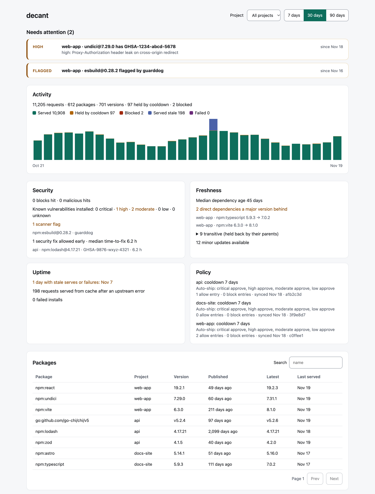

# decant

A self-hosted package cache and supply-chain gate for npm and Go, running on Cloudflare Workers and R2.

New releases rest before they're poured: decant serves a version only after it has aged past a cooldown, been scanned, and cleared your policy. Versions you depend on stay cached even if they vanish upstream, and your builds keep working when the public registries don't.

**Status:** Worker live; Action ready, unreleased. Docs: [deploy](docs/deploy.md), [adopt](docs/adopt.md), [hardening](docs/hardening.md), [release](docs/release.md).

*The private dashboard, behind Cloudflare Access (sample data).*

## Goals

- **Cooldown.** A new version becomes installable only after it is N days old (default 7).
- **Scan.** New versions are checked for known vulnerabilities and malware heuristics before use.
- **Keep.** Versions in use are kept in R2, so rollbacks work even after an upstream deletion.
- **Survive outages.** Cached packages are served when npm, GitHub or the Go proxy are down.
- **Base images too.** Every Dockerfile `FROM` must be pinned by digest; a new digest waits out the same cooldown (counted from when decant first verified it) and is scanned with Grype in the PR. The daily audit bumps digests that fix High or Critical findings.
- **Security fast lane.** A fix for a known advisory can skip the cooldown (never the scan) via a policy entry that cites the advisory ID.
- **Policy as code.** One policy file in your repo; approval is a merged PR, and git history is the audit trail.
- **Cheap to self-host.** `wrangler deploy` into your own Cloudflare account.

**Fewer dependencies, not more.** Once a version is cached, installs depend only on Cloudflare (the Worker, R2 and D1). npm, the Go proxy, OSV and GitHub can all be down and your builds keep working. If you already rely on Cloudflare, decant removes dependencies from your release path while making it more secure.

## How it works

- Your npm and Go clients point at the Worker instead of the public registries.
- The Worker fetches upstream metadata and hides versions that are too new or blocked.
- Package bytes are stored in R2 and served unmodified, so checksums still match.
- Per-project policy (cooldown, allow and block lists) lives in D1, synced from your repo.
- A daily cron re-checks stored versions against OSV and blocks any newly flagged as malicious.
- Tokens are per project: `read` for installs, `sync` for main-branch policy sync, `ci` for overlays and verdicts, and one operator token for admin.

v1 supports npm and Go, plus Docker base images in CI (pinned by digest, cooldown, Grype scan). See [docs/deploy.md](docs/deploy.md) to set it up. The image gate checks the Dockerfile as written: a `--build-arg` that changes a `FROM` at build time bypasses it (the scan warns on such lines; see [adopt](docs/adopt.md#pin-base-images-by-digest)).

**Upgrading:** the daily audit now needs the `sync` token (`environment: decant-sync` and `sync-token` in `decant-audit.yml`), and the Worker needs migration 0008. See [release notes](docs/release.md) and [adopt](docs/adopt.md#upgrading-audit-needs-the-sync-token).

Optional private dashboard (behind Cloudflare Access): [setup](docs/deploy.md#dashboard-optional).
